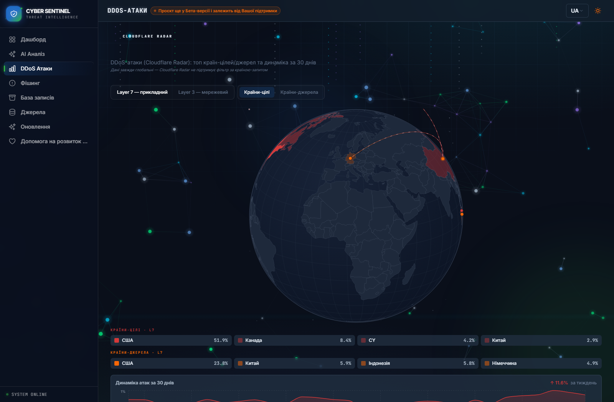
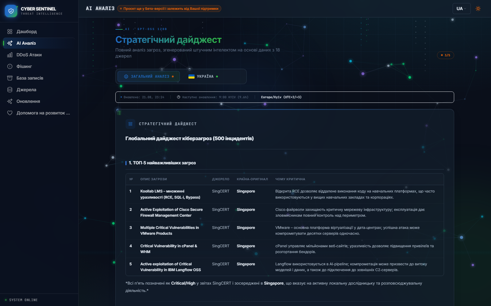
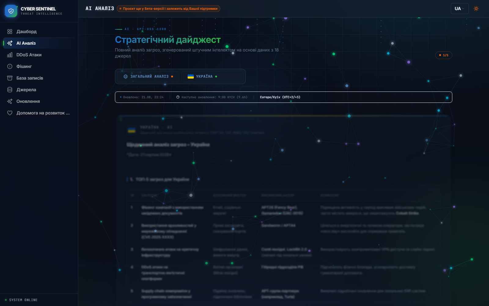
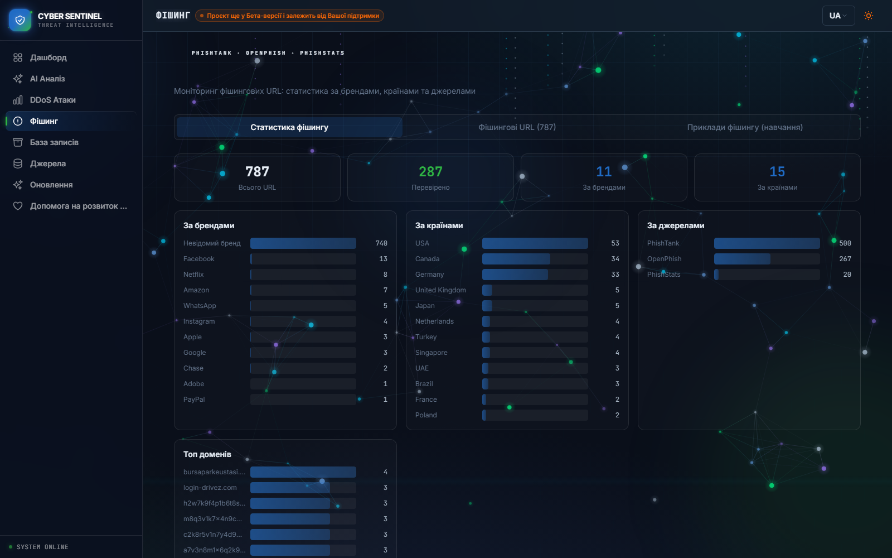
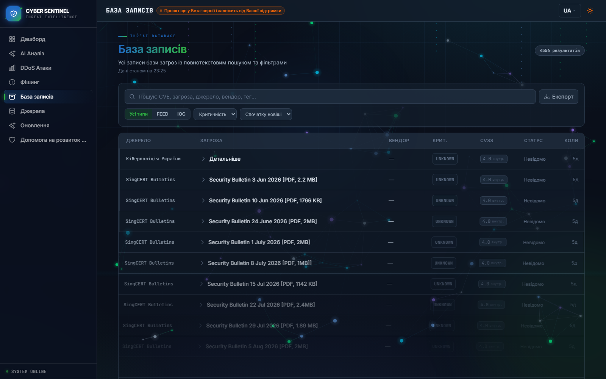
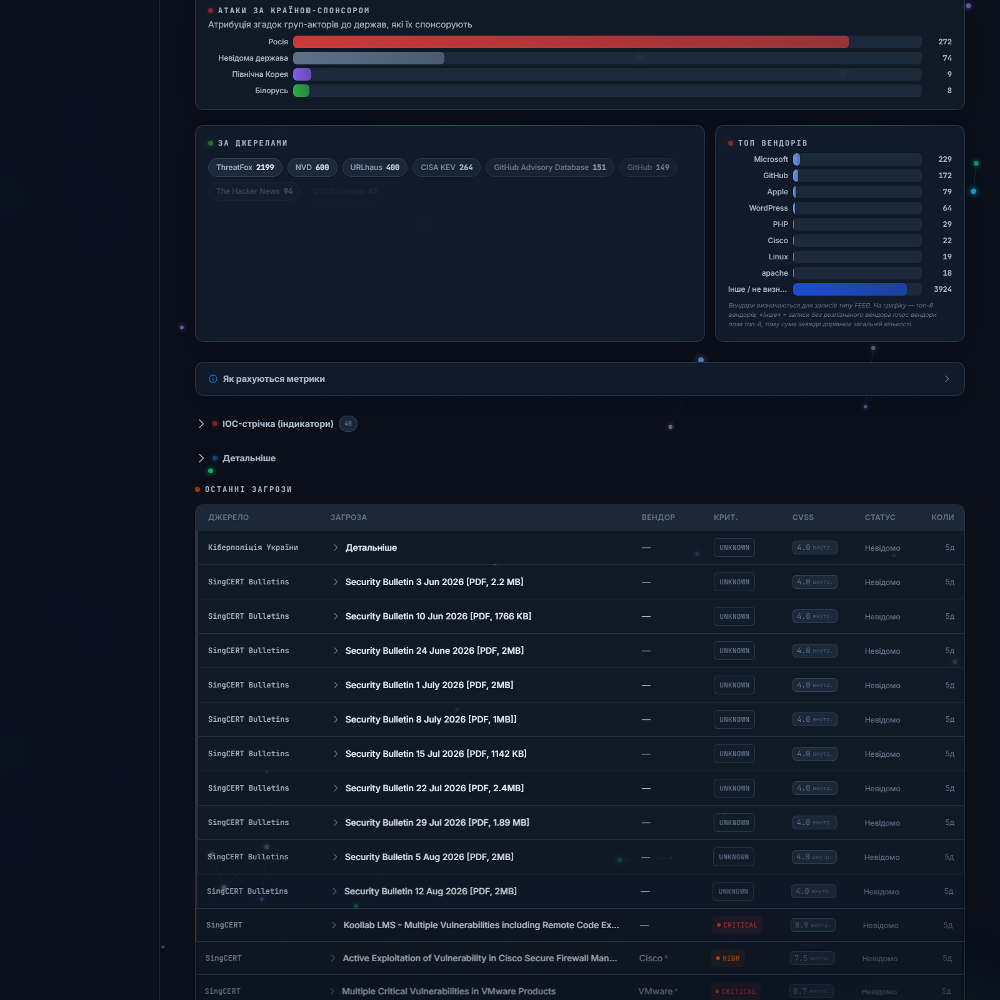
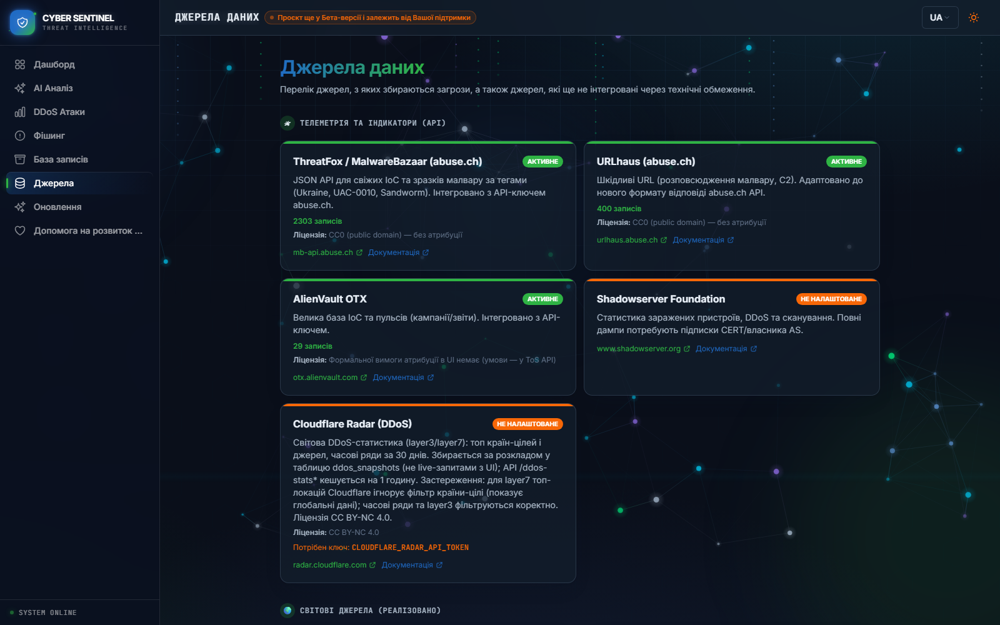

<div align="center">

# 🛡️ Cyber Sentinel

**Global cyber threat intelligence platform — with a dedicated Ukraine focus**

*Formerly known as UA Cyber Threat Dashboard · v1.6.0*

[](#-changelog-highlights)
[](https://nextjs.org)
[](https://fastapi.tiangolo.com)
[](https://groq.com)
[](#-five-languages)

</div>

---

## 👁 What is Cyber Sentinel?

Cyber Sentinel aggregates **18+ open threat-intelligence feeds** — NVD, CISA KEV,
CERT-UA, MISP Galaxy, MITRE ATT&CK, Cloudflare Radar, OpenPhish, PhishTank,
ThreatFox and more — normalizes them into a single threat model, enriches every
record (EPSS scores, CVSS, geo-location, severity, APT attribution) and serves it
all through a futuristic real-time dashboard, a REST API and **five daily
AI-generated analyses**.

> One console for the whole picture: what is happening, who is behind it,
> where it strikes — and what to do about it.

---

## 🖼 Screenshot Tour

> 📸 *Live captures from the running stack (backend :8010 + frontend :3001), v1.6.0.*

### 1. Mission Control — the main dashboard


The heart of the platform. Five KPI cards (Critical threats, Active exploits,
New CVE 24h, UA alerts, EPSS risk) open onto a living wall of intelligence:
a pulsing connection strip, a full-width **threat activity timeline**, the
interactive world map synchronized with the top-countries panel, the
APT **actor Sankey** tracker and the sponsor-state bar chart.
Every card has a methodology tooltip — hover it to learn how the number
is computed.

**What to look at:** the Ukraine card sits permanently on the dashboard with a
one-tap button that jumps straight into the AI Ukraine analysis.

---

### 2. The DDoS Planet



Not another flat choropleth — a slowly rotating **3D-style planet**
(d3-geo orthographic projection). Attack flows are drawn as glowing arcs
flying from origin countries (orange) to target countries (red), complete
with moving particles, pulsing rings on the hottest spots, an atmospheric
glow and a starfield backdrop.

**What to look at:** grab the planet and spin it yourself — auto-rotation pauses
while you drag. Below the globe: top target/origin rankings per Layer 7 / Layer 3
and the 30-day attack trend with week-over-week delta. Powered by Cloudflare Radar.

---

### 3. AI Analysis — two rooms, one brain



Five independent analyses are generated daily by **Groq GPT-OSS 120B** and
refreshed automatically at **09:00 Kyiv**:

| # | Tab | What it answers |
|---|-----|-----------------|
| 1 | Strategic Digest | Global trends, key findings, risks, recommendations |
| 2 | DDoS | Vectors, actors, defense strategy |
| 3 | IOC | APT groups, TTPs, detection signatures |
| 4 | Vendor | Which vendors/products are burning today |
| 5 | 🇺🇦 Ukraine | Dedicated Ukrainian-segment deep dive |

Readiness dots show green when an analysis is cached, yellow while it regenerates.

---

### 4. 🇺🇦 Ukraine AI Focus



A separate daily report built **only from Ukraine-relevant records**: CERT-UA
advisories, RNBO, SSU, SSSCIP bulletins, UAC-\* cluster mentions and keyword
matches. The prompt distills them into five sections — active campaigns,
threat-actor clusters, sectoral risk, malicious infrastructure and concrete
recommendations.

**What to look at:** deep-link `/ai?tab=ukraine` opens this room directly;
the flag in the tab bar takes you there from anywhere.

---

### 5. Phishing Desk



Live phishing URLs from **OpenPhish, PhishTank and PhishStats** — brand
impersonation ratings, target-country geo-resolution, verification status.
Includes AI-generated example phishing letters for security-awareness training.

---

### 6. Records Database



Full-text search (350 ms debounce) across every stored threat with type /
severity filters and sorting. Export included. Every row shows CVSS or the
proprietary `local_score`, exploit maturity, EPSS probability, tags and
attributed countries.

---

### 7. Attribution Engine



Every detected APT group is mapped to its **sponsor state** via a curated
dictionary (`ACTOR_SPONSOR`): Russia (Gamaredon, Sandworm, Turla, APT28…),
China (Volt Typhoon, Mustang Panda…), North Korea (Lazarus, Kimsuky…),
Iran (APT33–35), Belarus (Ghostwriter). Unattributed dynamic clusters land
in the "Unknown state" bucket — so the invariant always holds:

```
Σ(by_sponsor) = Σ(by_actor)   ✔ verified by scripts/attribution_check.py
```

Solid Sankey links = country confirmed inside the record; dashed links =
typical target from `ACTOR_TARGETS`.

---

### 8. Sources Transparency



Full transparency page: every collector, its license, freshness and record
count — including honest "planned / not configured" states for sources that
still need an API key.

---

## ⚙️ Architecture

```
 Collectors (18+ open sources)
        ↓
 Normalizer → single Threat model (+ severity inference)
        ↓
 Storage (bulk upsert, dedup by source+external_id)
        ↓
 Enrichment (EPSS, GeoIP, vendor extraction, actor attribution)
        ↓
 SQLite / PostgreSQL ──→ FastAPI (:8010)
                              │
              /stats /threats /ai/* /ddos-stats /phishing/*
                              │
              ┌───────────────┴────────────────┐
              ↓                                ↓
     Next.js 14 dashboard            Groq GPT-OSS 120B
     (5 languages, SSR i18n)        (5 daily analyses)
```

## 🧠 The AI layer

- **Groq GPT-OSS 120B**, structured prompts per analysis type
- Generated at server start + refreshed daily at 09:00 Europe/Kyiv
- In-memory cache, `/ai/status` exposes readiness (X/5 badge in UI)
- Ukraine analysis filters the corpus before prompting — no global noise

## 🗺 Data sources (highlights)

| Source | Role |
|---|---|
| NVD / CISA KEV | CVEs, known exploited vulnerabilities |
| CERT-UA | Official Ukrainian alerts (+ archive backfill since 2022) |
| MISP Galaxy / MITRE ATT&CK / OFAC SDN | Threat-actor clusters & sanctions mapping |
| Cloudflare Radar | Global DDoS statistics |
| OpenPhish / PhishTank / PhishStats | Live phishing URLs |
| ThreatFox / abuse.ch | IOC exchange |

## 🚀 Getting started

```bash
# Backend
python -m venv .venv && .venv\Scripts\activate
pip install -r requirements.txt
cp .env.example .env          # add GROQ_API_KEY, tokens…
uvicorn app.main:app --port 8010

# Frontend
cd frontend
npm install
npm run dev -- -p 3001        # http://localhost:3001
```

Optional keys unlock extra sources: `CLOUDFLARE_RADAR_API_TOKEN`,
`NVD_API_KEY`, `OTX_API_KEY`, `INTELX_API_KEY`, `SHOC…`

## 🔌 API cheat-sheet

| Endpoint | Description |
|---|---|
| `GET /stats` | All dashboard aggregates (coherent by construction: Σ parts = total) |
| `GET /stats/attribution` | Actor → sponsor-state totals |
| `GET /threats` | Paginated, filterable threat feed |
| `GET /ddos-stats` | Cached Cloudflare Radar snapshots |
| `GET /phishing/stats` | Phishing corpus statistics |
| `GET /ai/{digest\|ddos\|ioc\|vendor\|ukraine}` | Daily AI analyses (503 until ready) |
| `GET /ai/status` | Cache readiness + schedule info |
| `POST /ai/refresh` | Force regeneration now |

## 🌍 Five languages

🇺🇦 Українська · 🇬🇧 English · 🇵🇱 Polski · 🇫🇷 Français · 🇩🇪 Deutsch
— full localization including methodology tooltips, map legends and AI tabs.

## ⚠️ Disclaimers

Geo-locations reflect the physical position of (often rented or compromised)
infrastructure — not the nationality of an attacker. For state sponsorship see
the Attribution panel. AI texts are analytical estimates, not ground truth.

<div align="center">

**Cyber Sentinel** · real-time intelligence, built with ☕ and stubbornness

</div>
