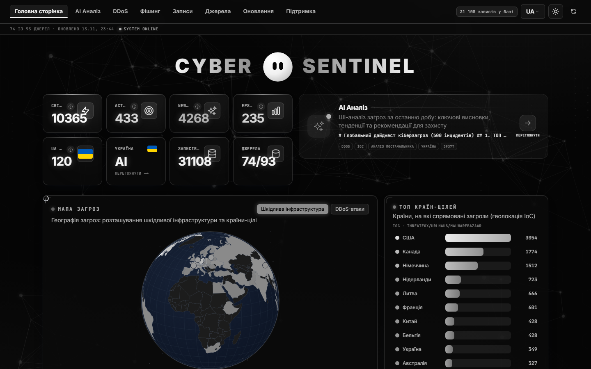
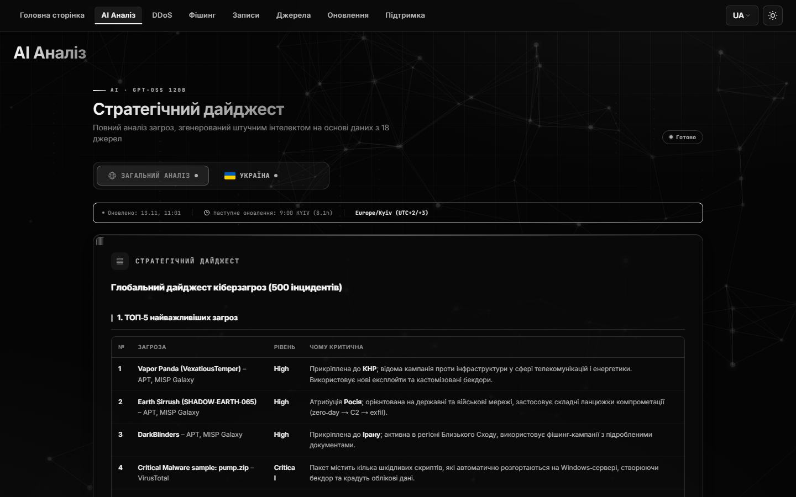
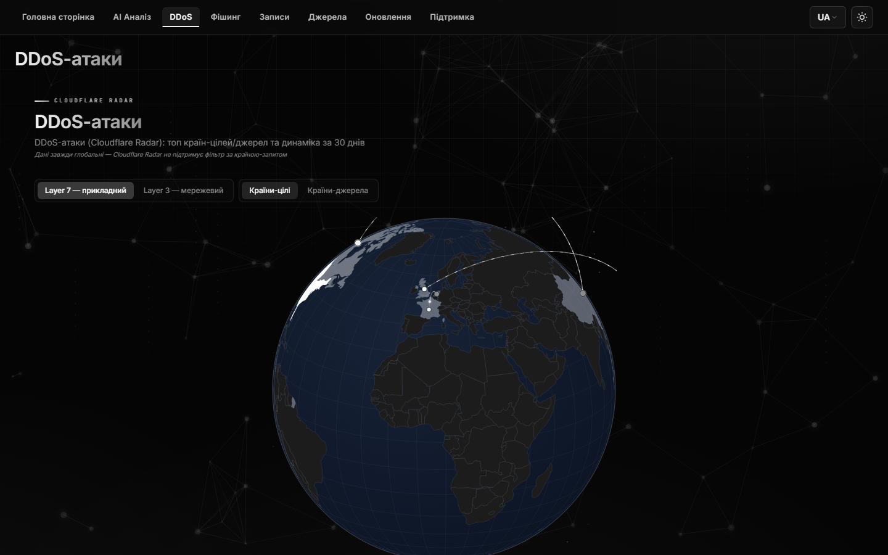

# CYBER SENTINEL — AI Cyber Security Dashboard

**Реалтайм-платформа анализа киберугроз: FastAPI + Next.js, чёрно-белый HUD-стиль с живым агентом.**

Aggregator of global threat intelligence with a Ukrainian focus: 90+ open sources,
hourly auto-refresh, AI analysis (Groq), DDoS/Phishing monitoring and an interactive
threat map — wrapped in a strict black-and-white design with a living agent mascot.



---

## ✨ Features

- 🎛 **Dashboard** — Critical / Active / New 24h / UA alerts / EPSS risk + AI-аналіз України,
  total records and sources counter, side-by-side AI Analysis panel
- 🤖 **Living agent** — the `CYBER agent SENTINEL` logo: blinks, breathes, idle scenes,
  laughs and jumps on hover; emotions are shaped purely by eyes (8 moods)
- 🗺 **Threat & DDoS planets** — orthographic globe with pulsing markers and animated attack arcs
- 📊 **Charts** — grayscale bars/series distinguished by density, pattern and glow (no colors)
- 🤖 **AI Analysis** — digest, DDoS, IOC, Vendor and Ukraine reports generated by LLM,
  auto-retried every 15 minutes until all 5 are ready
- 🎣 **Phishing monitor** — PhishTank / OpenPhish / PhishStats with brand & country stats
- 🗃 **Records database** — full-text search + filters: severity, source, vendor, exploit
  maturity, CVE, date range, threat-actor, CSV export
- 🕸 **Attribution** — Sankey `actor → country`, sponsor chart, sponsor-infrastructure lens
- 🌐 **5 languages** — uk / en / pl / fr / de (cookie-based, SSR-safe)
- 🌗 **Dark / light themes** — both strictly monochrome; red `#E5322D` appears **only** on the angry agent





---

## 🏗 Architecture

```
frontend/   Next.js 14 · React 18 · TypeScript · Tailwind 3   (port 3001)
app/        FastAPI · SQLAlchemy · APScheduler-style pipeline   (port 8010)
data/       SQLite: threats · ddos_snapshots · phishing_urls · dataset_snapshots
docs/       Design system · Architecture · Runbook
```

- **Auto-update**: background scheduler runs the collection pipeline **every hour**
  (child process, tick 300 s, `next_due` recomputed after the run finishes).
- **40+ collectors**: NVD, CISA KEV, Exploit-DB, CERT-UA, RNBO, SSU, SSSCIP, MITRE ATT&CK,
  MISP Galaxy, OFAC SDN, ThreatFox, URLhaus, MalwareBazaar, VirusTotal, AlienVault OTX,
  Cloudflare Radar, PhishTank, OpenPhish, blocklists, RSS/CERT feeds and more.
- **Graceful degradation**: one broken source never stops the pipeline.

Full details: [docs/02-ARCHITECTURE.md](docs/02-ARCHITECTURE.md) ·
Design tokens & animations: [docs/01-DESIGN.md](docs/01-DESIGN.md)

---

## 🚀 Quick start

```bash
# 1. Backend
python -m venv .venv
.venv\Scripts\pip install -r requirements.txt
.venv\Scripts\python -m uvicorn app.main:app --host 127.0.0.1 --port 8010

# 2. Frontend (another terminal)
cd frontend
npm install
npm run dev -- -p 3001
```

Open **http://localhost:3001**.

### Configuration

Copy `.env.example` → `.env` and fill in your keys (Groq, Cloudflare Radar, VirusTotal,
Abuse.ch, Shodan, NVD…). **`.env` is git-ignored and never pushed** — only the empty
template `.env.example` lives in the repository.

Key options:

| Variable | Default | Meaning |
|---|---|---|
| `DATABASE_URL` | `sqlite:///./data/threats.db` | any SQLAlchemy URL (PostgreSQL works) |
| `ENABLE_COLLECT_SCHEDULER` | `1` | hourly background collection |
| `COLLECT_INTERVAL_HOURS` | `1` | update period, hours |
| `AI_RETRY_MINUTES` | `15` | retry missing AI analyses |
| `ENABLE_API_DOCS` | off | expose `/docs` + OpenAPI |

---

## 🎨 Design at a glance

- **Monochrome only**: ink-on-dark-paper; semantic tokens (critical/warning/signal/info)
  are gray RGB triplets in CSS variables, theme-aware via `.dark`.
- **Severity = density**: Critical solid fill → High bold border → Medium thin border →
  Low plain → Unknown dashed.
- **Top navigation** with a sliding active underline (250 ms spring), «More ▾» dropdown
  below 1100 px, full-screen burger menu below 768 px.
- **Status line**: `74 із 93 джерел · оновлено … · System Online` + records counter in the corner.
- Animations respect `prefers-reduced-motion`; particles pause on hidden tabs.

---

## 📄 License & support

Personal non-commercial project. If it helps you —
[support development](https://ko-fi.com/arthurpetrunko).

---

**CYBER SENTINEL · REAL-TIME INTELLIGENCE**
